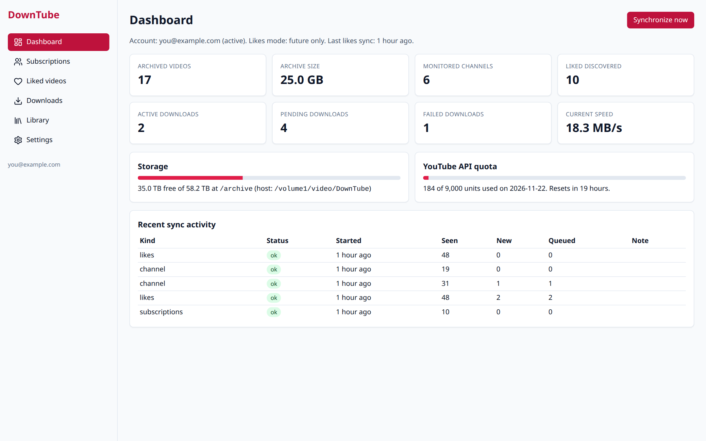

# DownTube

DownTube is an open-source, self-hosted YouTube archiving app. It runs as a single Docker
container on your own server (for example a NAS or a home server), discovers videos through
your YouTube account, and stores validated MP4 files in a folder you control, ready for a
media server such as Plex to index.

DownTube is not affiliated with or endorsed by Google or YouTube.



**Status.** Used in production since v0.2 on a Synology NAS behind a reverse proxy with HTTPS. Real Google sign-in
(OAuth with PKCE), the YouTube Data API v3, subscription and like archiving, and restart recovery of
interrupted downloads have been verified live. Current release: see the [CHANGELOG](CHANGELOG.md).

> **Use responsibly.** Archiving YouTube content is restricted by YouTube's Terms of Service
> and API policies. Only archive content you have the right to keep. See
> [Legal and responsibility notice](#legal-and-responsibility-notice) below.

## Features

- **Liked-video archiving.** Polls your liked videos and archives new likes. Optionally
  archives your historical likes as well.
- **Subscription archiving.** Per-channel rules with four modes:
  `off`, `backfill_once`, `backfill_and_follow` and `follow_new`. Filters include shorts,
  livestreams, a publish-date cutoff and a maximum duration.
- **Quality policy.** Selects the best *original* stream up to a per-rule maximum:
  - hard cap at 4K (2160p, measured on the short side, so portrait video counts correctly);
  - never upscales;
  - never re-encodes video; ffmpeg only stream-copies;
  - MP4 by default, with an optional MKV fallback when no MP4-compatible combination exists;
  - AAC audio by default, with Opus available as an option.
- **Validation before publication.** Each download is checked with ffprobe (container,
  resolution, audio, duration) before it is moved into the archive.
- **Upgrades.** When a video you already archived is liked or matches a higher-quality rule,
  DownTube fetches the better version and replaces the old file only after the new one is validated.
- **Download queue.** Retries with backoff, pause/resume/cancel, a download window and
  bandwidth limits, and a free-disk-space guard.
- **Media-server metadata.** Writes the title and full YouTube description to an `.nfo` file next to
  each video (Plex NFO agent, Jellyfin, Emby, Kodi) and stores them as tags inside new MP4 files
  (read by Plex in any library type). A Settings button adds `.nfo` files to videos archived earlier.
- **Library clean-up.** Delete a video from the Library: the files go, and DownTube never downloads it
  again. For a liked video it can also remove the like on YouTube.
- **Unsubscribe from the app.** Unsubscribing turns the channel's archiving off and keeps what is
  already archived. Removing likes and unsubscribing use an optional extra Google permission
  that you grant only if you want these actions; otherwise DownTube only reads your account.
  Once unsubscribed, **delete** the channel from the Subscriptions list: its archived videos stay
  in the library, and if you subscribe again it reappears with them.
- **Sort by release date.** The library shows when each video was released and when it was
  archived, and sorts by either; missing release dates are fetched automatically.
- **Import what DownTube can't fetch.** Age-restricted and other sign-in-only videos fail in the
  queue. **Download myself** gives a ready-made yt-dlp command to run on your own computer, where
  you are signed in to YouTube, and you upload the file or copy it into the import folder
  (`<archive>/.import`). DownTube checks it (container, duration, video ID, resolution limit) and
  archives it like any other download. Every download also links to the video on YouTube.
- **Quota-aware.** Tracks YouTube Data API usage against a daily budget.
- **Web UI and REST API.** Browse subscriptions, likes, jobs and the library; OpenAPI docs at `/api/docs` (signed-in users only).

## Quick start

DownTube is distributed as the container image `ghcr.io/jasoneameslamarca/downtube`.
The web UI listens on port **8092**.

1. Create a Google Cloud OAuth client. Follow [docs/installation.md](docs/installation.md).
2. Create a `.env` file next to your `docker-compose.yml` with at least:

   ```ini
   DOWNTUBE_SECRET_KEY=<at least 32 random characters>
   DOWNTUBE_BASE_URL=http://localhost:8092
   ```

3. Start the container and read the one-time setup code from the log:

   ```bash
   docker compose up -d
   docker logs downtube | grep "setup code"
   ```

4. Open `http://localhost:8092/setup` (or use an SSH tunnel, see the installation guide). Enter the
   setup code, paste your Google client ID and secret, and list the allowed Google accounts. The page
   shows the redirect URI to register in your Google OAuth client.
5. Sign in with an allowlisted Google account and acknowledge the rights notice.

Environment variables for the Google client and allowed accounts also work, and they take precedence
over the setup page.

For NAS-specific steps see [docs/synology.md](docs/synology.md).

## Requirements

- Docker with the Compose plugin, on Linux, macOS or a NAS that supports Container Manager.
- A Google account with access to the YouTube Data API v3 (free, quota-based).
- Storage for your archive. Plan for several hundred gigabytes or more; 4K VP9/AV1 files are large.
- Network access from the server to `youtube.com` and `googleapis.com`.

The image bundles yt-dlp, ffmpeg and a JavaScript runtime that yt-dlp needs for YouTube.
You do not install these yourself.

## Documentation

| Document | Contents |
|---|---|
| [docs/DownTube-Guide.docx](docs/DownTube-Guide.docx) | End-to-end guide (Word document): from Google Cloud setup to daily use |
| [docs/installation.md](docs/installation.md) | Google Cloud setup, configuration, first login, archiving options |
| [docs/synology.md](docs/synology.md) | Synology DSM 7 and Container Manager guide |
| [docs/quality-policy.md](docs/quality-policy.md) | Resolution, codec, audio and container rules in detail |
| [docs/operations.md](docs/operations.md) | Updates, backups, troubleshooting, error codes, logs |
| [docs/development.md](docs/development.md) | Architecture, API, database, job states, testing |
| [docs/architecture/CONTRACTS.md](docs/architecture/CONTRACTS.md) | Internal contracts (source of truth for design) |
| [PRIVACY.md](PRIVACY.md) | What data DownTube stores and how to remove it |
| [SECURITY.md](SECURITY.md) | Security design and how to report vulnerabilities |
| [CONTRIBUTING.md](CONTRIBUTING.md) | Development setup and contribution workflow |
| [CHANGELOG.md](CHANGELOG.md) | Release history |

Screenshots and diagrams used in the guide live in [docs/images/](docs/images/). They use fictional demo
data and can be regenerated with the tools in [tools/](tools/docs-screenshots/README.md).

## Known limitations

- **Likes history is limited by the API.** The YouTube Data API returns only the newest
  1000 liked videos. DownTube polls frequently and keeps what it has seen, but likes that
  fall outside the newest 1000 cannot be enumerated again.
- **Bot checks.** YouTube sometimes asks yt-dlp to prove it is not a bot. Some server IP
  addresses are blocked more often than others. These downloads are retried with long backoff.
- **H.264 tops out at 1080p on YouTube.** Resolutions above 1080p (up to 4K) are only
  available as VP9 or AV1. These are stored in MP4 and some Plex clients will transcode them.
  See [docs/quality-policy.md](docs/quality-policy.md#5-mp4-compatibility).
- **Google OAuth redirect URIs cannot be raw IP addresses.** Use `localhost` with an SSH
  tunnel (not possible on Synology DSM, which forbids TCP forwarding), or an HTTPS hostname
  under a public domain. A private LAN IP such as `192.168.x.x`
  is rejected by Google.
- **Unverified-app warning.** Because DownTube uses a sensitive scope and is not a verified
  app, Google shows a warning screen during consent. The limit is 100 users over the life of the project.
- **Testing-mode tokens expire after 7 days.** If the OAuth consent screen stays in
  *Testing*, refresh tokens expire weekly and you must reconnect. Publish the app to
  *In production* for personal use (see the installation guide).

## Legal and responsibility notice

- You are responsible for what you archive. Only archive content you have the right to keep,
  for your own personal, non-commercial use, and in compliance with the laws where you live.
- YouTube's Terms of Service and the YouTube API Services Terms and Developer Policies restrict
  downloading, storing and offline use of YouTube content. DownTube does not grant you any
  permission under those terms.
- DownTube respects access controls. It reports DRM, paywalls, geographic restrictions,
  age and membership gates, and login requirements. It never attempts to bypass them, and it never
  receives or stores YouTube cookies. For sign-in-only videos you can download a file yourself, with
  your own account, and import it; that download is yours and must follow the same rules.
- DownTube does not redistribute content. Do not share the archive or make it available to others.
- This notice is not legal advice.

## License

DownTube is released under the [MIT License](LICENSE).

Copyright (c) 2026 Jason Eames Lamarca and DownTube contributors.

## Not affiliated

DownTube is not affiliated with or endorsed by Google or YouTube. YouTube is a trademark of Google LLC.
